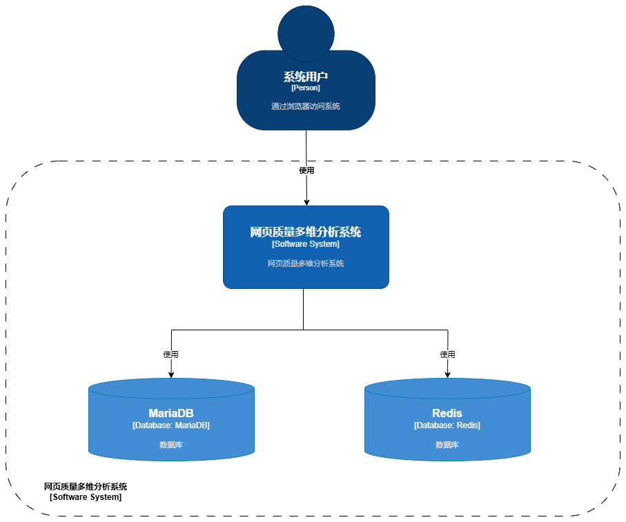
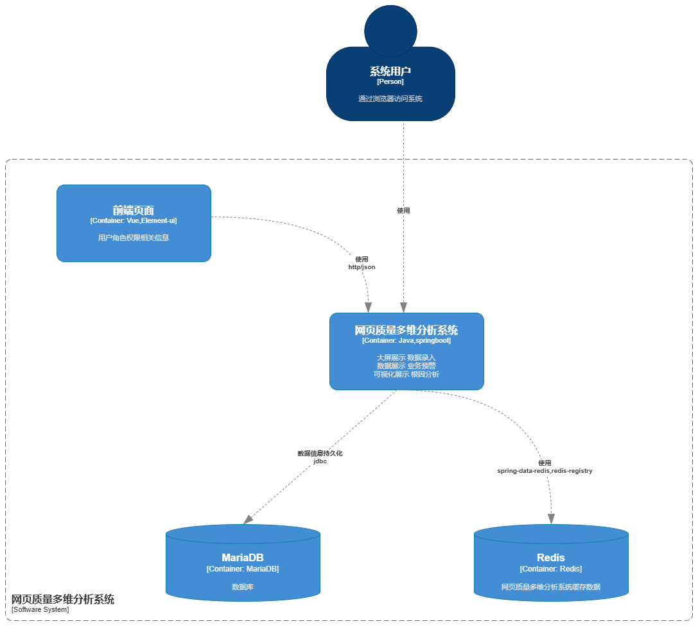
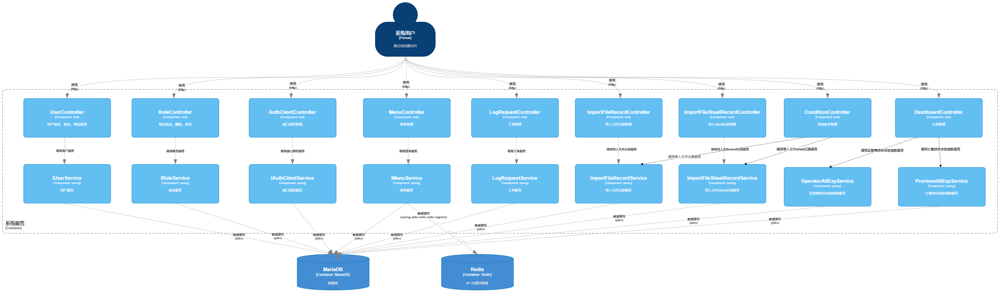
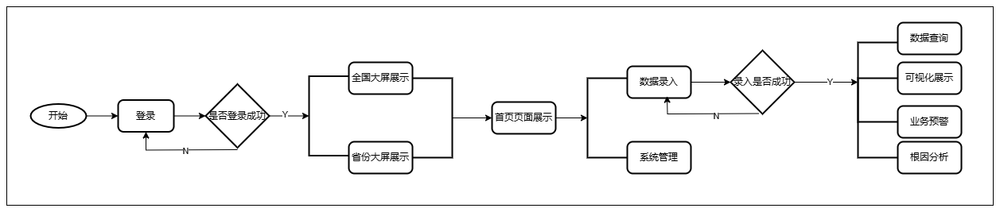

##  项目描述
大模型数据分析平台前端代码

本项目主要用于录入网页质量数据并进行多维分析。

##  项目的基本结构
``` 
Project
├── mock -- 模拟数据配置
├── public -- 静态资源目录
├── src -- 源代码目录
├    ├── api -- 接口文件 
├    ├── components -- 自定义全局组件 
├    ├── config -- 全局配置文件 
├    ├── lang -- 多国语言包 
├    ├── option -- 通用数据文件 
├    ├── page -- 全局页面文件
├    ├── router -- 路由管理器文件 
├    ├── store -- 状态管理器文件 
├    ├── styles -- 全局样式配置文件 
├    ├── theme -- 全局主题配置 
├    ├── util -- 通用工具类 
├    ├── views -- index视图层目录 
├    ├── App.vue -- 项目主组件 
├    ├── main.js -- 项目启动文件 
├    └── permission.js -- 全局路由权限配置 
├── .env. -- 环境变量配置文件
├── .gitignore -- git配置文件
├── index.html -- 默认访问文件
├── .babel.config.js -- babel配置文件
├── .browserslistrc -- 浏览器适配版本
├── package.json -- 项目依赖包集合
└── vue.config.js -- vue配置文件
```

## 项目架构

### Context



### Container



### Component



### 流程图



##  项目技术栈

| 技术栈                  | 版本         |
|----------------------|------------|
| NodeJS               | 18+        |
| vue                  | 3.4.27+    |
| vite                 | 5.2.12+    |
| element-plus         | 2.7.3+     |
| avue                 | 3.4.4+     |
| echarts              | 5.5.1+     |

##  项目详细介绍

本项目通过数据录入获取网页质量相关数据。
将获取的数据通过全国大屏展示或省份大屏展示，全国大屏总体总师登陆后获取，省份大屏省份总师登录后获取。
支持查看和下载相应月份的原始报表，能够根据条件查询。
支持将网络质量和业务质量相关数据通过趋势图和排名图展示。
支持对网络参数和业务参数进行阈值设置和预警提醒。
支持对预警进行根因分析列出排名最差的三个省份和指标下降最多的三个省份。

###  基础构建工具
> 技术栈 —— NodeJs:18+

##  如何开发/运行/部署

下述命令需在 `根目录` 下执行

``` bash
# 安装依赖
npm install

# 开发模式
npm run serve

# 打包命令
npm run build

```

##  版本升级说明

[V1.0](doc/v1.0.0/v1.0.0.md)
